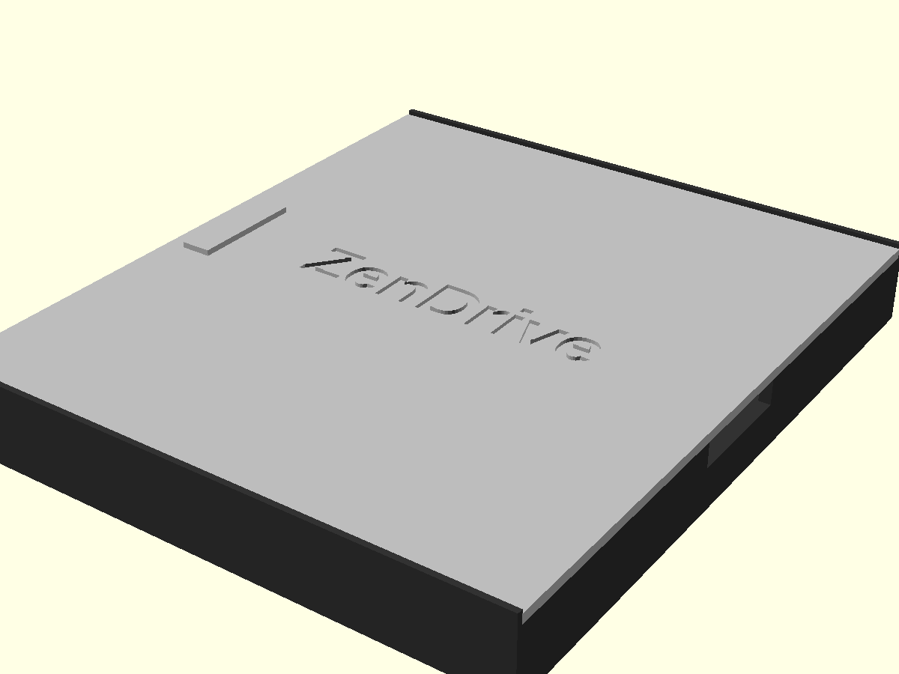
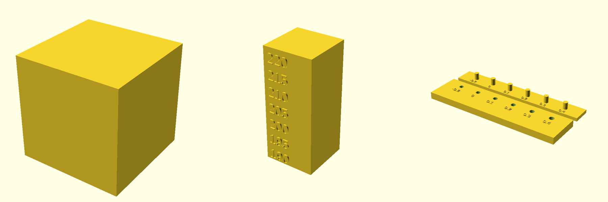
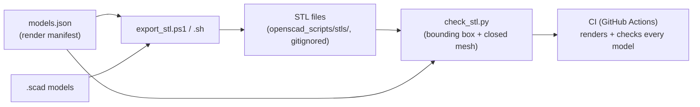

# openscad-toolkit

## Description

Parametric OpenSCAD models, calibration prints, and render-and-verify
tooling for the Bambu Lab P1S. Everything is designed in millimeters.

What you get: three calibration models (a 20 mm cube, a temperature
tower, and a tolerance test), a sliding-lid storage box for the ASUS
ZenDrive U9M, a Bambu P1S quick reference, a starter print profile
(as a mapping reference, not an importable file), and export scripts
that render every model to STL and verify the result. This is a
collection of models plus tooling — not a library of reusable OpenSCAD
modules, despite the "toolkit" name.



## Prerequisites

- [OpenSCAD](https://openscad.org/downloads.html) 2021.01 or newer
  (the export scripts, the Customizer comments, and the `assert`
  checks all target this version).
- Liberation Sans Bold, for the ZenDrive lid engraving. OpenSCAD
  substitutes a fallback font if it is missing, which changes the
  engraving width without changing the bounding box — so a missing
  font will not fail CI, but the engraving will look different.
- Python 3.9 or newer (standard library only). On Linux/macOS the
  export script also uses it to read `models.json`, so it is required
  there; on Windows the export script reads the manifest natively,
  and Python is only needed for the verification step
  (`scripts/check_stl.py`).
- PowerShell 5.1 or newer (Windows only, for `export_stl.ps1`).
- Git, to clone the repository.

## Installation

There is nothing to build or install — this repository is source
files plus scripts. Clone it, install OpenSCAD, and render:

```sh
git clone https://github.com/enonymous1/openscad-toolkit.git
cd openscad-toolkit
```

Get OpenSCAD from [openscad.org/downloads.html](https://openscad.org/downloads.html)
(the installer for Windows/macOS, or your distribution's package on
Linux; for example `sudo apt-get install openscad` on Ubuntu).

Verify your setup by rendering everything. On Windows (PowerShell,
from the repo root):

```powershell
.\scripts\export_stl.ps1
```

On Linux / macOS:

```sh
./scripts/export_stl.sh
```

A successful run ends with six `PASS` lines, one per STL. Generated
STLs land in `openscad_scripts/stls/` and are not committed.

<!-- Visual V6: docs/assets/export-demo.gif — a real terminal run of
     ./scripts/export_stl.sh ending in the six PASS lines. Place it
     here, next to the verification command, so a new user can compare
     their output against the expected output. -->

## Models



Sizes below are checker-verified bounding boxes (what
`scripts/check_stl.py` enforces), not nominal model sizes — labels
and pins stick out past the nominal dimensions, and the difference
is stated in each row.

| Model | File | Rendered bounding box |
| --- | --- | --- |
| Calibration cube, 20 × 20 × 20 mm | `openscad_scripts/examples/calibration_cube.scad` | 20 × 20 × 20 mm |
| Temperature tower, 190–220 °C sections with embossed labels | `openscad_scripts/examples/temperature_tower.scad` | 30 × 31.6 × 70 mm (31.6 mm deep: the front labels protrude 0.8 mm past the 30 mm block) |
| Tolerance test: hole plate + pin strip, clearances −0.2 to +0.4 mm | `openscad_scripts/examples/tolerance_test.scad` | Plate 120 × 30 × 6.6 mm (labels rise 0.6 mm above the 6 mm plate); strip 120 × 16 × 9 mm overall (3 mm strip + 6 mm pins) |
| ASUS ZenDrive U9M storage box with sliding lid | `openscad_scripts/zendrive_u9m_box/zendrive_u9m_box.scad` | Box 150.5 × 175.0 × 21.4 mm; lid 150.5 × 171.6 × 4 mm (including the grip) |

Also included: a Bambu P1S quick reference and OpenSCAD best
practices (`printer_information/bambu_p1s.md`), and a starter print
profile as a mapping reference (`profiles/bambu_p1s_profile.sample.json`,
not an importable Bambu Studio file — see `profiles/README.md`).

## Local Development

### Rendering one model

To open a model in the OpenSCAD GUI, open the `.scad` file and press
F6 to render (F5 is preview only and uses approximations — always
render before exporting). The ZenDrive file's `part_to_render`
Customizer selects Box, Lid, Both, or Assembled; the tolerance test's
selects Plate, Pins, or Both. From the command line, select a part
with `-D`, for example:

```sh
openscad --render --export-format binstl -D 'part_to_render="Box"' \
  -o zendrive_u9m_box-box.stl \
  openscad_scripts/zendrive_u9m_box/zendrive_u9m_box.scad
```

The export scripts render the ZenDrive box and lid as separate files
(the `Both` and `Assembled` views are previews only: a single STL
holding two separate solids is confusing to slice), then run
`scripts/check_stl.py`, which checks each STL's bounding box against
the table above and that its mesh is closed (every edge shared by
exactly two triangles — what a slicer needs).

To run the checker on its own, after a render:

```sh
python3 scripts/check_stl.py openscad_scripts/stls
```

### How the pipeline fits together



### Adding a model

Adding a model touches three places, plus this README:

1. Add the `.scad` file under `openscad_scripts/`.
2. Add an entry to `models.json` (source plus one output per STL,
   with a `define` part selector where the model has parts). Both
   export scripts render exactly what the manifest lists — do not
   add render calls to the scripts.
3. Add its expected bounding box to `EXPECTED` in
   `scripts/check_stl.py`. The checker and the manifest test fail
   loudly if the manifest and `EXPECTED` disagree.
4. Add a row to the Models table above, with the checker-verified
   bounding box (render first, then copy the PASS line's numbers).

### Running the CI steps locally

```sh
python3 -m json.tool models.json > /dev/null
python3 -m unittest discover tests -v
./scripts/export_stl.sh
python3 scripts/check_stl.py openscad_scripts/stls
python3 -m json.tool profiles/bambu_p1s_profile.sample.json > /dev/null
```

If any step fails, fix the model or the script — do not commit the
generated STLs to work around it. The CI workflow
(`.github/workflows/ci.yml`) runs exactly these steps, plus a check
that no `.stl`, `.pdf`, `.gcode`, or `.3mf` file is tracked.

## Printing notes

- Start with the calibration examples: print the cube to check
  dimensions and flow, the temperature tower to pick a temperature
  for a filament, and the tolerance test to pick a clearance before
  printing a fitting part. For the tolerance test, flip the pin strip
  face-down onto the hole plate; the stations line up left to right,
  and clearance is the diametral play
  (hole diameter = pin diameter + clearance). Note the pins sit at
  the strip's centerline while the holes sit at +7.5 mm on the plate,
  so align the strip to the hole row by eye — the test is not
  self-locating.

<!-- Visual V3: docs/assets/tolerance-closeup.png — tolerance plate
     with a pin station engaged (or the Both preview cropped to one
     station, label readable). Place it here, next to the flip-the-strip
     paragraph. -->

- The ZenDrive box dimensions are for the ASUS ZenDrive U9M
  (SDRW-08U9M-U). Verify them against your own drive before
  printing. Its lid fit has been verified only by rendering so far —
  the lid renders seated in its groove in the `Assembled` preview —
  and has not yet been test-printed. **Print the lid first and check
  that it slides in the groove before committing to the full box.**

<!-- Visual V4: docs/assets/lid-section.svg — cross-section through
     the groove showing wall, groove floor, lid, divider top, and the
     0.4 mm sliding tolerance. Place it here, next to the lid-first
     warning, so a reader can reason about the fit before printing. -->

- Bambu Lab's manuals are not included in this repo. The P1S
  reference here summarizes the manufacturer's published
  specifications; consult the official documentation for the full
  guides.

## Deployment

There is no hosted application to deploy — this repository ships
source, not a service. "Shipping" here means:

1. Push to `main`. CI (`.github/workflows/ci.yml`) renders every
   model on Ubuntu, checks bounding boxes and closed meshes, validates
   the profile JSON, and fails if any generated artifact is tracked.
2. Tag the release (`git tag v2.0.2`, for example) and add a
   CHANGELOG entry describing what changed. Tags, not the README,
   are the version of record.
3. Never commit generated STLs, and do not attach rendered STLs to a
   release until the lid fit has been test-printed — shipping STLs
   of render-only geometry would bless a fit that is still
   unverified.

## Project layout

```text
openscad-toolkit/
├── models.json             # Render manifest (single source of truth)
├── docs/assets/            # Visual assets (renders, not photographs)
├── openscad_scripts/       # OpenSCAD source files
│   ├── examples/           # Calibration and test models
│   └── zendrive_u9m_box/   # ZenDrive U9M storage box
├── printer_information/    # Bambu Lab P1S reference
├── profiles/               # Starter print profile (mapping reference)
├── scripts/                # STL export (PowerShell + shell) and STL checks
└── .github/workflows/      # CI: renders and checks every model
```

## History

Version 2.0.0 (2026-10-28) is a fresh single-commit export, renamed
from ss-openSCAD before publishing. The original 2026-07-19 history
is not carried over: it was a single commit under a student email
address, and it bundled Bambu Lab's copyrighted manuals into the
repository. 2.0.1 (2026-11-01) added checker docstrings, clean parse
failures, and committed checker tests. 2.0.2 (2026-11-01) fixed
stale-STL handling in both export scripts (generated outputs are
cleared up front and each target is deleted before its render; a missing python3 is now an error unless
`--skip-check` is passed on Linux/macOS) and rewrote this README with
Description, Prerequisites, Installation, Local Development, and
Deployment sections and checker-verified sizes. 2.0.3 (2026-11-01)
named the ZenDrive divider/groove constants, fixed the cable-side wall
to a full 3 mm (box and lid each 0.5 mm wider), lowered the divider to
clear the sliding lid, and made unknown `part_to_render` values fail
instead of silently rendering Both. 2.0.4 (2026-11-01) introduced
`models.json` as the single render list read by both export scripts
and cross-checked by the checker, with manifest tests and CI steps;
the shell export now requires python3 to read the manifest. 2.0.5
(2026-11-01) added the first real visual assets: a rendered hero image
of the assembled ZenDrive box and a calibration trio image, both in
`docs/assets/` with capture commands documented there; the pipeline
diagram (Mermaid) was already in this README since 2.0.2. See
`CHANGELOG.md`
for what changed in each version.

## License

[MIT](LICENSE)
